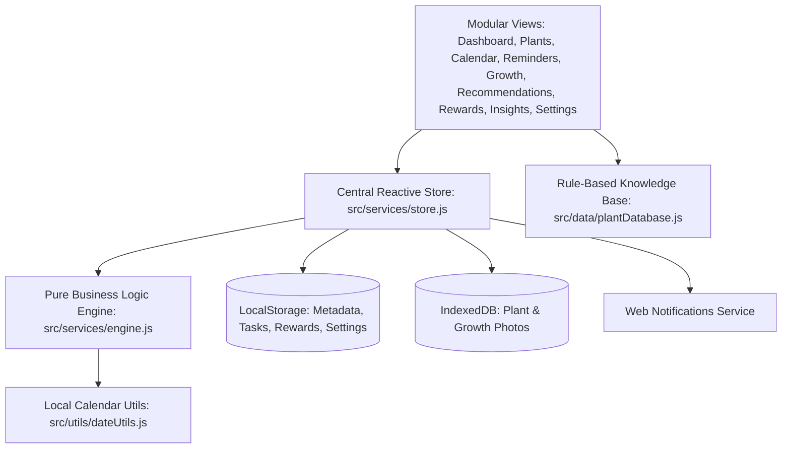

# PlantCare — Smart Plant Care Management System

**Tagline:** *Grow Better, Care Smarter.*

PlantCare is a modern, responsive, browser-based Plant Care Management System designed for home gardeners and indoor plant enthusiasts. It enables users to organise their plant collection, build recurring care schedules, prioritise reminders, maintain a photographic growth diary, consult rule-based botanical care guidance, and track care consistency through streaks and rewards — without requiring IoT hardware or cloud accounts.

---

## Problem Statement

Home gardeners and beginner plant caretakers frequently struggle to keep track of different watering, fertilising, pruning, and sunlight routines across multiple indoor and outdoor plants. Existing solutions are often either generic to-do lists lacking plant-specific scheduling logic or expensive IoT-sensor ecosystems that create a cost and setup barrier for everyday users.

## Project Objectives

1. Provide a clean, accessible, zero-hardware web application for multi-plant management.
2. Implement accurate local-date recurring care scheduling across month boundaries and leap years.
3. Build a priority-based reminder engine that highlights overdue and due-today tasks without auto-completing missed work.
4. Store plant and growth-diary photographs locally using browser **IndexedDB** while keeping lightweight structured records in **LocalStorage**.
5. Offer a transparent, rule-based plant care recommendation engine for common home plants.
6. Encourage consistent care habits through duplicate-proof reward points, streaks, and data-driven Chart.js analytics.

## Proposed Solution

PlantCare combines a modular ES6+ frontend with dual browser persistence (`LocalStorage` + `IndexedDB`), Chart.js visualisations, and a decoupled business-logic engine. Every calculation — task priority, recurring next-due date, streak counts, and dashboard statistics — is computed dynamically from stored user records.

## Main Features

- **Dashboard:** Dynamic KPIs (total plants, due today, overdue, completed), 7-day Chart.js care progress chart, upcoming task quick-complete, recent activity feed, and fresh-install empty state.
- **My Plants (CRUD):** Add, view, edit, and safely delete plants (with cascade cleanup of related tasks and IndexedDB photos), plus search, category filter, location filter, and detailed individual plant profiles.
- **Care Calendar & Scheduler:** Monthly view, weekly view, and daily task list with colour-coded task statuses, custom repeat intervals, pause/resume controls, and local-date math.
- **Priority-Based Reminder Engine:** Automatically ranks tasks (`High` for overdue, `Medium` for due today, `Normal` for upcoming), supports Complete, Snooze (+1 day), Reschedule, Skip, and Web Notifications API integration.
- **Plant Growth Diary:** Chronological timeline with IndexedDB photograph uploads and side-by-side Before-and-After visual comparison.
- **Rule-Based Recommendations:** General care guidance (watering, sunlight, fertilising, soil, tips) for 10+ common plants plus category fallbacks, with one-click schedule pre-filling.
- **Rewards & Streaks:** Duplicate-proof points (+10 per task, +20 daily sweep bonus), real completion-date streak tracking, achievement badges, and reward history.
- **Care Insights:** Real-data Chart.js dashboards covering weekly completion rate, 30-day activity trends, and plant-wise summaries.
- **Settings & Data Portability:** User profile preferences, sample demo-data loader/reset, validated JSON export/import (including embedded photos), and destructive reset confirmation.

## Technology Stack

- **Frontend:** HTML5, CSS3, JavaScript (ES6+ modules)
- **Build & Dev Server:** Vite 6
- **Visualisations:** Chart.js 4
- **Iconography:** Lucide (`lucide`)
- **Storage:** Web `localStorage` + `IndexedDB`
- **Browser APIs:** Date API, Web Notifications API, FileReader / Canvas API
- **Testing:** Vitest + JSDOM

## Architecture Overview



For full architectural details, see [docs/SYSTEM_ARCHITECTURE.md](docs/SYSTEM_ARCHITECTURE.md).

## Folder Structure

```text
PLANTCARE-SMART-PLANT-CARE-MANAGEMENT-SYSTEM/
├── index.html
├── package.json
├── vite.config.js
├── .gitignore
├── public/
│   ├── icons/
│   └── images/
├── src/
│   ├── main.js
│   ├── styles/
│   │   ├── main.css
│   │   ├── components.css
│   │   └── responsive.css
│   ├── modules/
│   │   ├── dashboard.js
│   │   ├── plants.js
│   │   ├── scheduler.js
│   │   ├── reminders.js
│   │   ├── growth.js
│   │   ├── recommendations.js
│   │   ├── rewards.js
│   │   ├── insights.js
│   │   ├── settings.js
│   │   └── modals.js
│   ├── services/
│   │   ├── store.js
│   │   ├── engine.js
│   │   ├── storage.js
│   │   ├── database.js
│   │   └── notification.js
│   ├── data/
│   │   └── plantDatabase.js
│   └── utils/
│       ├── dateUtils.js
│       ├── helpers.js
│       └── ui.js
├── tests/
│   ├── dateUtils.test.js
│   ├── engine.test.js
│   └── storageAndRecommendations.test.js
└── docs/
    ├── PROJECT_OVERVIEW.md
    ├── SYSTEM_ARCHITECTURE.md
    ├── FEATURES.md
    ├── TECHNOLOGY_STACK.md
    ├── INSTALLATION_GUIDE.md
    ├── TESTING_REPORT.md
    └── FUTURE_SCOPE.md
```

## Installation & Running the Application

```bash
# 1. Clone the repository
git clone https://github.com/pavanchakravarti23/PLANTCARE-SMART-PLANT-CARE-MANAGEMENT-SYSTEM.git
cd PLANTCARE-SMART-PLANT-CARE-MANAGEMENT-SYSTEM

# 2. Install dependencies
npm install

# 3. Start the Vite development server
npm run dev

# 4. Run automated unit & integration tests
npm test

# 5. Build for production
npm run build
```

See [docs/INSTALLATION_GUIDE.md](docs/INSTALLATION_GUIDE.md) for detailed instructions.

## Screenshots

Screenshots of the running application (Dashboard, My Plants, Care Calendar, Reminders, Growth Diary Before/After Comparison, Recommendations, Rewards, Care Insights, and Settings) can be captured from `npm run preview` during project evaluation and placed under `docs/screenshots/`.

## Limitations

- **Rule-Based Recommendations:** The care recommendation module uses a structured static knowledge base rather than a trained AI/ML model and provides general starting guidance only.
- **No IoT Hardware / Sensors:** PlantCare v1 does not connect to soil moisture, light, or temperature sensors.
- **No Automated Disease Diagnosis:** PlantCare does not inspect photos to diagnose pests or plant diseases.
- **Local Browser Storage Only:** Data is persisted in the user's current browser (`localStorage` and `IndexedDB`) and is not automatically synchronised across devices or cloud accounts.
- **Browser Notification Scope:** Web Notifications require explicit user permission and only fire while the PlantCare web page is open in the browser (no background push server is used).

## Future Enhancements

See [docs/FUTURE_SCOPE.md](docs/FUTURE_SCOPE.md) for planned extensions including optional cloud sync, PWA offline caching with push notifications, seasonal weather adjustments, and optional sensor integrations.

## Project Documentation

- [Project Overview](docs/PROJECT_OVERVIEW.md)
- [System Architecture](docs/SYSTEM_ARCHITECTURE.md)
- [Features Specification](docs/FEATURES.md)
- [Technology Stack](docs/TECHNOLOGY_STACK.md)
- [Installation Guide](docs/INSTALLATION_GUIDE.md)
- [Testing Report](docs/TESTING_REPORT.md)
- [Future Scope](docs/FUTURE_SCOPE.md)

## License

MIT License — see [LICENSE](LICENSE).
