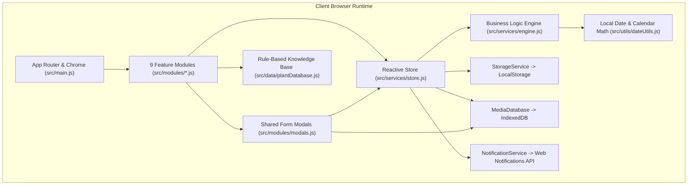
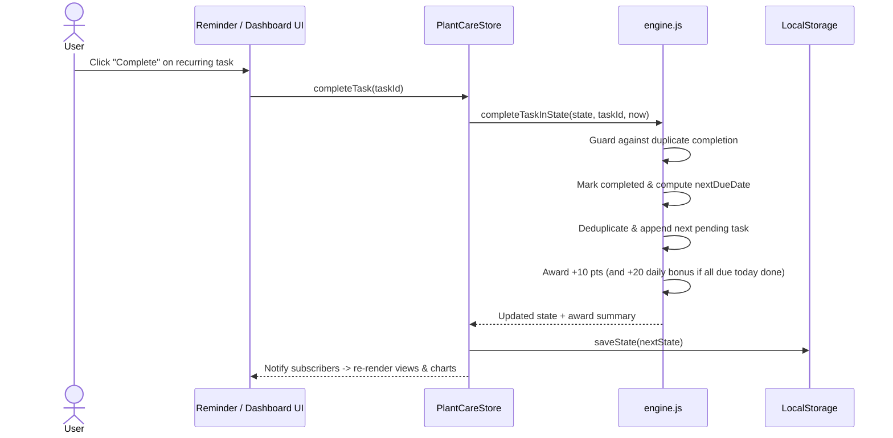

# System Architecture — PlantCare

## 1. Architectural Pattern

PlantCare follows a **layered, modular client-side architecture** separating presentation, state orchestration, pure business logic, and browser persistence:

1. **Presentation Layer (`src/modules/*.js`, `src/styles/*.css`)**
   Renders each view from current application state, sanitises all user-supplied strings (`escapeHtml`), mounts Lucide icons, and binds interactive form/modal actions.
2. **State & Reactive Store (`src/services/store.js`)**
   Acts as the single coordinator between UI modules, pure logic (`engine.js`), `StorageService`, `MediaDatabase`, and `NotificationService`.
3. **Pure Business Logic Layer (`src/services/engine.js`, `src/utils/dateUtils.js`)**
   Implements framework-independent, deterministic functions for priority sorting, recurring date calculation, idempotent task completion, duplicate-proof rewards, streak computation, and cascade deletion.
4. **Data & Persistence Layer (`src/services/storage.js`, `src/services/database.js`, `src/data/plantDatabase.js`)**
   - `StorageService`: Manages schema-validated JSON persistence in `localStorage` (`plantcare_app_data_v1`) and handles recovery from corrupted JSON.
   - `MediaDatabase`: Manages binary/DataURL plant and growth photographs in IndexedDB (`plantcare_media_db`, object store `images`).
   - `plantDatabase.js`: Structured rule-based botanical knowledge base with 10+ detailed plant profiles and category fallbacks.

## 2. System Architecture Diagram

## 3. Data Flow: Task Completion & Recurring Scheduling

## 4. Data Model Summary

| Entity | Storage | Key Fields |
| :--- | :--- | :--- |
| `PLANT` | LocalStorage | `id`, `name`, `type`, `category`, `imageId`, `fallbackImage`, `dateAdded`, `location`, `sunlightPreference`, `wateringInterval`, `fertilisingInterval`, `notes` |
| `CARE_TASK` | LocalStorage | `id`, `plantId`, `activityType`, `title`, `dueDate`, `dueTime`, `repeatInterval`, `customIntervalDays`, `status`, `paused`, `notes`, `completedAt`, `nextDueDate` |
| `GROWTH_ENTRY` | LocalStorage | `id`, `plantId`, `imageId`, `fallbackImage`, `observationDate`, `description` |
| `REWARD` | LocalStorage | `id`, `taskId`, `points`, `awardedAt`, `reason` |
| `USER_SETTINGS` | LocalStorage | `displayName`, `notificationsEnabled`, `theme`, `preferences.dateFormat`, `preferences.timeFormat` |
| `IMAGE_RECORD` | IndexedDB | `id`, `dataUrl`, `mimeType`, `size`, `createdAt` |

## 5. Security & Reliability Design

- **XSS Prevention:** All dynamic text interpolated into DOM strings passes through `escapeHtml()` before rendering.
- **Upload Validation:** Uploaded photographs are checked for MIME type (`image/jpeg`, `image/png`, `image/webp`) and file size (≤ 5 MB), then resized via HTML5 Canvas before IndexedDB storage.
- **Schema Validation:** Both `localStorage` load and JSON import run `validateAndNormalizeState()` to protect against malformed or corrupted files.
- **Safe Cascade Deletion:** Deleting a plant removes its associated `CARE_TASK` and `GROWTH_ENTRY` records and cleans up orphaned `imageId` entries in IndexedDB.
